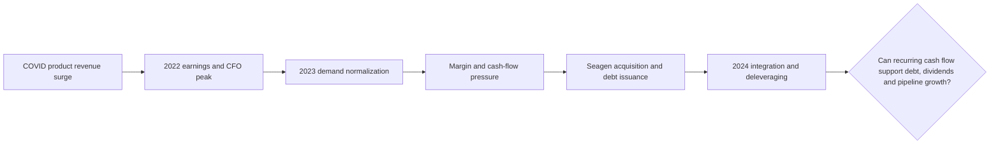

# Pfizer | Financial Statement Analysis (FY2021–FY2024)

### Can Pfizer rebuild sustainable profitability after the COVID-19 windfall while absorbing the Seagen acquisition?

**Equity & credit research case study · Financial Statement Analysis · MSc Finance group project**

This repository adapts a **90-page group report submitted on 4 December 2025** into a structured financial-analysis case study. It examines Pfizer's business model, reporting judgments, revenue normalization, cash generation, acquisition financing, solvency, earnings quality and relative performance against **Merck, Eli Lilly and AbbVie**.

**Analytical thesis:** Pfizer's 2024 improvement needs to be understood as a partial recovery from an unusually volatile 2021–2023 base—not automatically as proof of sustainable growth. The Seagen acquisition creates a second layer of analysis: a larger intangible-asset base, increased financing commitments and a dependence on successful pipeline commercialization.

> **Historical scope:** The assessment is based on FY2021–FY2024 and the group's December 2025 report. It is **not a current valuation, price target or investment recommendation**. Some numerical inconsistencies in the submitted report are explicitly flagged rather than concealed.

## Research dashboard — selected figures from the report

| Indicator | FY2022 | FY2023 | FY2024 | Interpretation |
| --- | ---: | ---: | ---: | --- |
| Reported revenue in the revenue chapter ($bn) | 101.2 | 59.6 | 63.6 | COVID-related demand normalized; partial recovery in 2024 |
| Cash from operations ($bn) | 29.27 | 8.70 | 12.74 | Cash generation improved but remained below pandemic levels |
| Investing cash flow ($bn) | −15.78 | −32.28 | +2.65 | Acquisition year followed by net investment inflows and asset sales |
| Financing cash flow ($bn) | −14.83 | +26.07 | −17.14 | Acquisition financing followed by repayments and distributions |
| CFO / CapEx | ~8.9× | 2.23× | 4.38× | Organic capital spending remained covered by operating cash |
| Current ratio | 2.31× | 1.58× | 1.48× | Liquidity normalized after pandemic peak |

*Figures are drawn from different sections of the submitted report and are not a fully reconciled dataset. In particular, the revenue and profitability chapters use inconsistent totals. See [reconciliation and methodological cautions](10-reconciliation-and-methodological-notes.md).*

## Explore the analysis

| Chapter | Key question |
| --- | --- |
| [01 · Investment thesis](01-investment-thesis.md) | What is the historical investment case and what could invalidate it? |
| [02 · Business and industry](02-business-and-industry.md) | How do patent cycles, R&D, competition and acquisitions shape Pfizer's economics? |
| [03 · Accounting and financial statements](03-accounting-and-financial-statements.md) | What do common-size statements and audit judgments reveal? |
| [04 · Revenue and commercial transition](04-revenue-analysis.md) | How should the COVID boom-and-bust be separated from recurring demand? |
| [05 · Cash flow and capital allocation](05-cash-flow-and-capital-allocation.md) | Can cash generation support investment, debt reduction and dividends? |
| [06 · Profitability and credit](06-profitability-and-credit-risk.md) | What do returns, leverage, liquidity and coverage actually measure? |
| [07 · Earnings quality](07-earnings-quality.md) | Which accounting estimates and non-GAAP adjustments require skepticism? |
| [08 · Peer benchmarking](08-peer-benchmarking.md) | What explains the differences from Merck, Lilly and AbbVie? |
| [09 · Historical conclusion](09-investment-conclusion.md) | How does the report balance recovery potential against execution risk? |
| [10 · Reconciliation and limitations](10-reconciliation-and-methodological-notes.md) | Which claims should be qualified before using the work in an interview? |
| [References and acknowledgements](references.md) | Sources, attribution and publication scope |

## Financial story

*Conceptual synthesis of the report's historical narrative; not a forecast.*

## What this project demonstrates

- Multi-year **three-statement analysis** and common-size financial reporting
- Interpretation of **revenue recognition, rebate accruals, acquired intangibles and impairment risk**
- **Cash-flow bridge** from operations to acquisition financing and distributions
- **Ratio analysis** with attention to denominators, nonrecurring items and capital structure
- **Cross-sectional pharmaceutical benchmarking** and investment judgment
- Critical assessment of **earnings quality and the limits of historical financial analysis**

## Acknowledgements

This project was developed collaboratively as part of the *Financial Statement Analysis* course. Thanks to **Robin Förster, Louis Häffner and Emanuele Licata** for their contributions.

The original 90-page submission contains student and group identifying information and is not redistributed here. This is a newly organized analytical presentation of the coursework; it does not claim that the entire group project was completed individually. **Educational analysis, not investment advice.**
